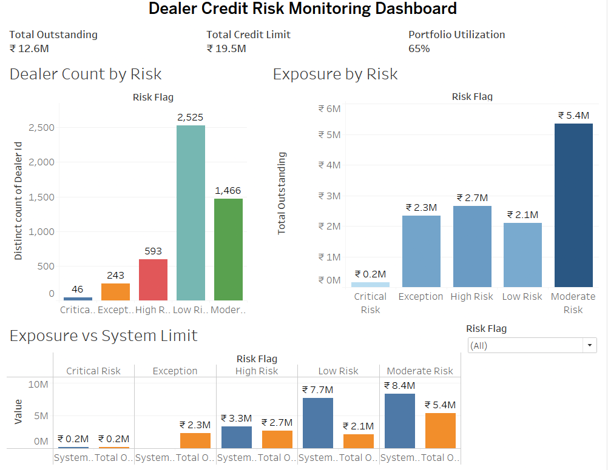

# Dealer Credit Risk Monitoring

Dealer credit exposure monitoring using percentile-based segmentation, a utilisation-based risk flag and a Tableau dashboard.

**Live dashboard:** [Tableau Public](https://public.tableau.com/views/DealerCreditRiskMonitoringDashboard/DealerCreditRiskMonitoring)

   

## Business Problem

Companies that extend trade credit to dealers face the risk of delayed payments and excessive credit exposure. Monitoring dealer-level exposure is critical to identify high-risk accounts and take timely credit control actions.

## Objective

Build a credit risk monitoring system that analyses dealer exposure and identifies high-risk accounts using portfolio-based segmentation.

## Approach

- Used percentile-based segmentation to handle skewed exposure data
- Built a utilisation-driven risk flag instead of a single static threshold
- Designed a conservative system that prioritises early risk detection over breach detection

## Dataset

- **Source:** Global Superstore sample sales dataset (public retail data, 2011-2014), used to simulate dealer receivables. Customers are treated as dealers and orders as invoices.
- **Size:** 4,873 dealers, 25,035 invoices (51,290 invoice lines)
- **Limitation:** The data has no payment dates or credit limits, so "outstanding" is the cumulative invoice value per dealer and credit limits are derived analytically.

## Methodology

### 1. Data Preparation
- Raw dataset imported using Power Query
- Data cleaned and transformed in Excel
- Aggregated dealer-level metrics: Total Outstanding, Invoice Count, Oldest Invoice Date

### 2. Exposure-Based Segmentation

Percentile thresholds (P25, P50, P75, P90, P95) were calculated on dealer exposure:

| Percentile Range | Limit Bucket |
| ---------------- | ------------ |
| < P25            | Low          |
| P25 - P75        | Medium       |
| P75 - P90        | High         |
| P90 - P95        | Very High    |
| > P95            | Exception    |

### 3. Credit Limit Simulation

No predefined limits existed, so system limits were derived from the buckets:
- Low: 2,000
- Medium: 4,000
- High: 7,000
- Very High: 9,000
- Exception: no system limit (manual approval required)

### 4. Utilisation-Based Risk Flag

**Utilisation = Total Outstanding / System Credit Limit**

| Utilisation | Risk Flag |
| ----------- | --------- |
| up to 50%   | Low       |
| 50% - 75%   | Moderate  |
| 75% - 90%   | High      |
| above 90%   | Critical  |

## Credit Control Framework

| Risk Level | Recommended Action                    |
| ---------- | ------------------------------------- |
| Low        | Normal operations                     |
| Moderate   | Increase monitoring frequency         |
| High       | Tighten terms / partial dispatch      |
| Critical   | Stop dispatch until exposure reduces  |
| Exception  | Credit committee approval required    |

## Results

| Risk Flag | Dealers | % of Dealers | % of Total Exposure |
| --------- | ------- | ------------ | ------------------- |
| Low       | 2,525   | 51.8%        | 16.7%               |
| Moderate  | 1,466   | 30.1%        | 42.4%               |
| High      | 593     | 12.2%        | 21.1%               |
| Critical  | 46      | 0.9%         | 1.3%                |
| Exception | 243     | 5.0%         | 18.5%               |

## Key Insights

- Exposure is concentrated: High, Critical and Exception dealers are 18% of dealers but hold about 41% of total exposure
- The top 10% of dealers by exposure hold about 31% of the total
- The 243 Exception dealers (above P95) are 5% of dealers but 18.5% of exposure, and need manual approval
- Critical flags mean "close to the ceiling of the dealer's own bucket", not "largest exposure". Limits step up by bucket, so a dealer just under a bucket limit shows high utilisation even with moderate exposure
- Utilisation highlights warning signals before an actual limit breach

## Dashboard (Tableau)

- Total Outstanding, Total Credit Limit, Utilisation
- Dealer Count by Risk
- Exposure by Risk
- Exposure vs System Limit

## Tools Used

- Excel (Power Query, data analysis)
- Tableau (dashboard)

## Project Structure

- `data/`: raw dataset
- `excel/`: data processing and risk logic
- `dashboard/`: Tableau dashboard

## Notes

- The sales data is public (Global Superstore). Credit limits are simulated and represent monitoring thresholds, not sanctioned limits.
- The risk flag is built from the same exposure figure that sets the limit, so it works as a monitoring and routing framework, not a default predictor.
- This is portfolio-level exposure monitoring, not collections tracking (DPD and ageing are not included).
